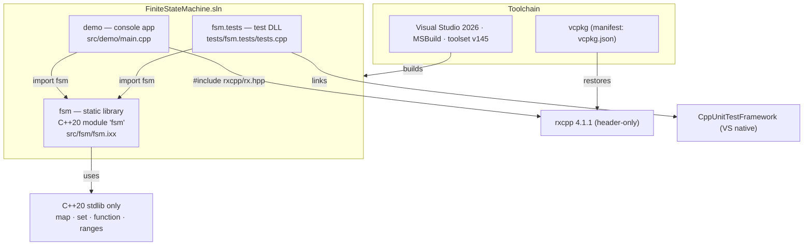
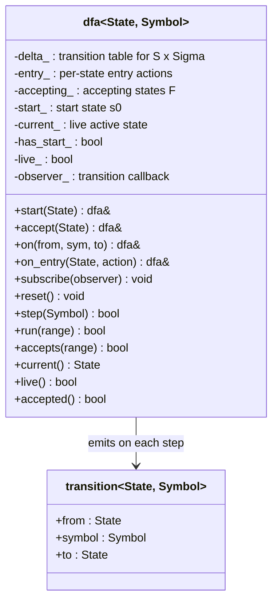
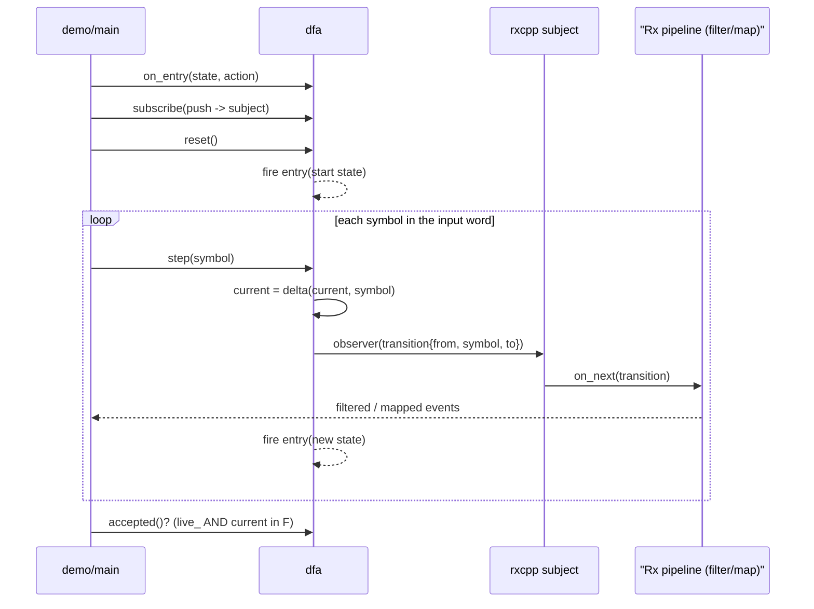
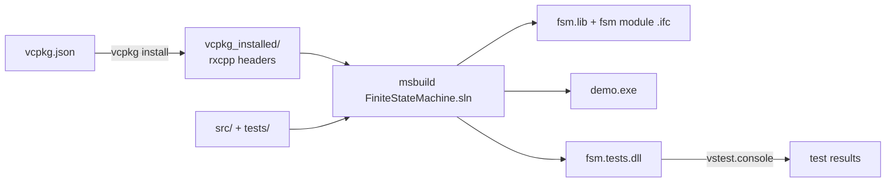

# FSM Architecture

A generic, header-light deterministic finite-state machine delivered as a C++20
module, with an RxCpp-based reactive transition stream, a console demo, and a
unit-test suite. Diagrams render in the VS / VS Code Markdown preview.

## Formal model → code

The machine implements the 5-tuple `M = (Σ, S, s0, δ, F)`:

| Formal      | Meaning                     | In `dfa<State, Symbol>`                  |
|-------------|-----------------------------|------------------------------------------|
| `Σ`         | input alphabet              | values of type `Symbol` (keys of `delta_`) |
| `S`         | set of states               | values of type `State`                   |
| `s0`        | start state                 | `start_` (set via `start()`)             |
| `δ`         | transition function S×Σ→S   | `delta_` : `map<State, map<Symbol,State>>` |
| `F`         | accepting states, F ⊆ S     | `accepting_` (set via `accept()`)        |

## Component & dependency view

The core `fsm` module depends only on the standard library. RxCpp is confined to
the **demo** (the reactive consumer), and the test framework to **fsm.tests**, so
the reusable machine stays dependency-free.

## Class view

Three API groups: a **chainable builder** (`start`/`accept`/`on`/`on_entry`),
**live execution** (`reset`/`step`/`run` + `current`/`live`/`accepted`), and a
side-effect-free **language query** (`accepts`). The single `subscribe` hook is
the seam the reactive layer plugs into.

## Reactive runtime flow

Per `step()`: advance state → notify the Rx transition observer → fire the new
state's entry action. The pure `accepts()` query does none of this.

## Build & test pipeline

